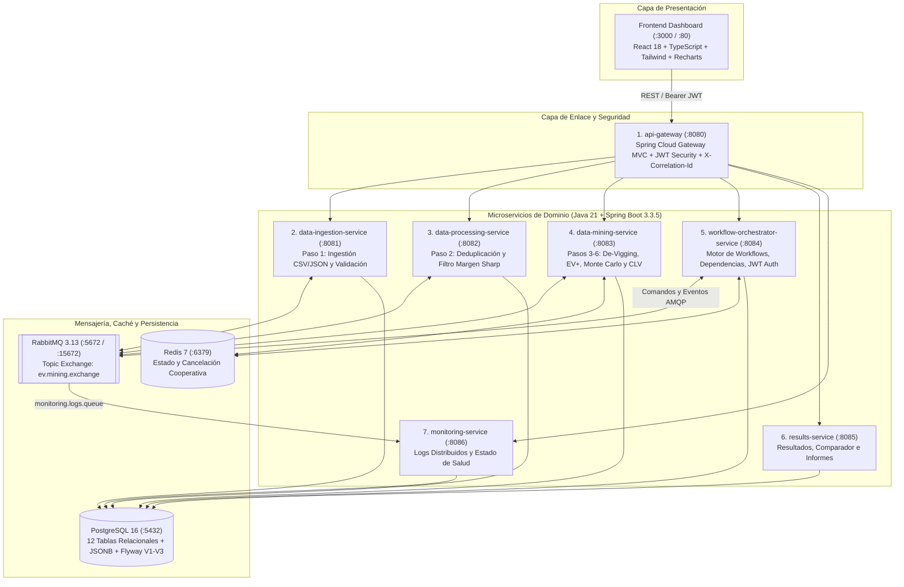
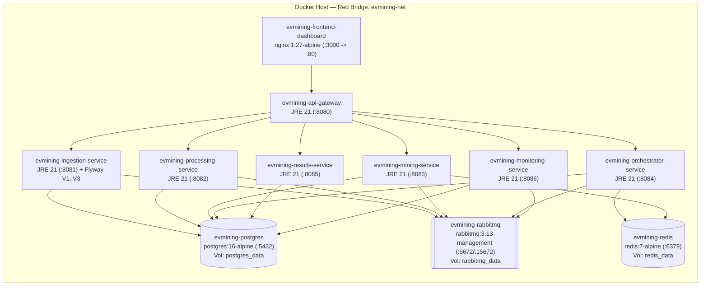

# EV+ & CLV Distributed Data Mining Platform (`v1.0.0`)

[](https://openjdk.org/projects/jdk/21/)
[](https://spring.io/projects/spring-boot)
[](https://www.rabbitmq.com/)
[](https://www.postgresql.org/)
[](https://react.dev/)

## 1. Descripción del Proyecto

**EV+ & CLV Distributed Data Mining Platform** es un sistema distribuido basado en microservicios desarrollados con **Java 21** y **Spring Boot 3.3.5**, diseñado para automatizar, auditar y reproducir procesos de **Data Mining sobre mercados de apuestas deportivas**.

Toda la metodología matemática implementada se basa estrictamente en el hilo técnico de **[@Porros365 en X](https://x.com/Porros365/status/2122822935002132523)** sobre **Apuestas con Valor Esperado Positivo ($\text{EV}+$) y Validación mediante Closing Line Value ($\text{CLV}$)**:

1. **Estimación de Probabilidad Real ($p_{\text{real}}$):** Referencia sobre las casas de apuestas más eficientes del mercado (*Sharp Bookmakers*: **Betfair Exchange, SingBet, Sbobet, Circa**).
2. **Eliminación de Margen (*De-Vigging*):** Cálculo del *overround* ($\sum 1/O_i - 1$) y eliminación de la comisión de la casa *sharp* (mediante métodos `MULTIPLICATIVE`, `ADDITIVE` o `POWER`) para obtener $p_{\text{real}}$ y la **Cuota Justa** ($O_{\text{justa}} = 1 / p_{\text{real}}$).
3. **Minería de Valor Esperado ($\text{EV}+$):** Comparación contra casas blandas (*Soft Bookmakers*: **Bet365, Paf, William Hill**) aplicando:
   $$\text{EV} = (p_{\text{real}} \times O_{\text{soft}}) - 1$$
4. **Gestión de Stake, Volumen y Varianza:** Dimensionamiento de *stake* (`FLAT_UNIT` de $1\text{u}$ o `FRACTIONAL_KELLY`), expectativa matemática a largo plazo ($500\text{ apuestas} \times 1\text{u} \times 5\% = +25\text{u}$) y **simulación estocástica de Monte Carlo** reproducible con semilla (`randomSeed`) para modelar rachas de 5 o 6 pérdidas consecutivas y *drawdown*.
5. **Auditoría Estadística de $\text{CLV}$ (*Closing Line Value*):**
   $$\text{CLV} = \frac{O_{\text{tomada}}}{O_{\text{cierre}}} - 1$$
   Complementada con correlación de Pearson $r(\text{EV}, \text{CLV})$, regresión lineal simple y contraste $t$ de Student unilateral ($H_1: \mu_{\text{CLV}} > 0$) mediante `Apache Commons Math`.

---

## 2. Objetivos

- Ejecutar cada uno de los **6 pasos de la metodología** tanto de forma **individual** (validando que las dependencias previas estén en estado `COMPLETED` o habilitando explícitamente `independentMode=true`) como en un **pipeline secuencial completo ($1 \to 6$)**.
- Garantizar **trazabilidad y reproducibilidad absoluta** en cada ejecución: versión del dataset con hash SHA-256 (`DatasetVersion`), versión del workflow (`Workflow`), versión del algoritmo (`AlgorithmVersion`), parámetros (`Configuration`), semilla aleatoria (`randomSeed`), versión del código (`codeVersion`), tiempos en milisegundos y logs distribuidos (`ExecutionLog`).
- Permitir **pausar/cancelar** ejecuciones en curso, **reintentar** pasos fallidos y **comparar distintas ejecuciones** lado a lado.

---

## 3. Arquitectura y Diagrama de Componentes

El sistema está compuesto por **7 microservicios backend** en Java 21 + Spring Boot 3.3.5, un módulo de dominio compartido (`common-domain`) y una aplicación web en **React 18 + TypeScript + Recharts** (`frontend-dashboard`).



---

## 4. Diagrama de Despliegue (Docker Compose)



---

## 5. Tecnologías Utilizadas

- **Backend:** Java 21, Spring Boot 3.3.5, Spring Web, Spring Data JPA (Hibernate 6.5), Spring Security + JJWT (`0.12.6`), Spring Validation, Spring AMQP (RabbitMQ), Spring Data Redis, Spring Cloud Gateway Server MVC (`2023.0.3`), Springdoc OpenAPI (`2.6.0`).
- **Data Mining y Estadística:** `Apache Commons Math 3.6.1` (`DescriptiveStatistics`, `Well19937c` PRNG para Monte Carlo con semilla, `PearsonsCorrelation`, `SimpleRegression`, `TTest`) y motores matemáticos nativos de *De-Vigging*, $\text{EV}+$ y $\text{CLV}$.
- **Persistencia y Migraciones:** PostgreSQL 16 (relacional + `JSONB`), Flyway (`V1`, `V2`, `V3`), Redis 7, H2 (modo PostgreSQL para tests rápidos de integración).
- **Frontend:** React 18.3, TypeScript 5.6, Vite 5.4, Tailwind CSS 3.4, Recharts 2.13, Lucide Icons.
- **DevOps y Calidad:** Docker, Docker Compose, GitHub Actions CI/CD, JUnit 5, Mockito, Spring Boot Test (`MockMvc`).

---

## 6. Estructura de Carpetas

```text
Apuestas/
├── .github/workflows/
│   └── ci-cd.yml                          # Pipeline CI/CD en GitHub Actions
├── api-gateway/                           # 1. API Gateway (:8080) + Dockerfile
├── common-domain/                         # Entidades JPA (12), Repositorios, Topología RabbitMQ, JWT y Flyway V1-V3
│   └── src/main/resources/db/migration/
│       ├── V1__init_schema.sql
│       ├── V2__seed_methodology_and_algorithms.sql
│       └── V3__seed_porros365_sample_dataset.sql
├── data-ingestion-service/                # 2. Data Ingestion Service (:8081 - Paso 1) + Dockerfile
├── data-processing-service/               # 3. Data Processing Service (:8082 - Paso 2) + Dockerfile
├── data-mining-service/                   # 4. Data Mining Service (:8083 - Pasos 3, 4, 5 y 6) + Dockerfile
├── workflow-orchestrator-service/         # 5. Workflow Orchestrator (:8084 - Estados, Dependencias y Auth) + Dockerfile
├── results-service/                       # 6. Results Service (:8085 - Resultados, Comparador e Informes) + Dockerfile
├── monitoring-service/                    # 7. Monitoring Service (:8086 - Logs Distribuidos y Salud) + Dockerfile
├── frontend-dashboard/                    # 8. Dashboard Web en React 18 + TypeScript + Recharts + Dockerfile
├── docs/
│   ├── FASE_0_REQUISITOS_Y_METODOLOGIA.md # Análisis del hilo de @Porros365 y fichas de los 6 pasos
│   ├── FASE_1_DISENO_ARQUITECTURA.md      # Diagramas UML, modelo de datos y ADRs (ADR-001 a ADR-004)
│   └── openapi-contract.yaml              # Contrato formal OpenAPI 3.0.3
├── docker-compose.yml                     # Despliegue completo de los 11 contenedores
├── .env.example                           # Plantilla de variables de entorno
└── pom.xml                                # Reactor Maven multi-módulo (v1.0.0)
```

---

## 7. Instalación y Ejecución

### Opción A — Despliegue Completo con Docker Compose (Recomendado)

Levanta PostgreSQL, RabbitMQ, Redis, los 7 microservicios backend (ejecutando automáticamente las migraciones Flyway `V1` a `V3` y cargando el dataset oficial de `@Porros365`) y el Dashboard Web:

```bash
docker compose up --build
```

Una vez levantado:
- **Dashboard Web Interactivo:** `http://localhost:3000`
- **API Gateway:** `http://localhost:8080`
- **Consola RabbitMQ Management:** `http://localhost:15672` (`guest` / `guest`)

### Opción B — Compilación y Ejecución Local para Desarrollo

```powershell
# 1. Levantar únicamente PostgreSQL, RabbitMQ y Redis en Docker:
docker compose up -d postgres rabbitmq redis

# 2. Compilar y ejecutar pruebas en todos los microservicios backend:
$env:JAVA_HOME="C:\Program Files\Java\latest\jdk-26"
& "C:\Programas\apache-maven-3.9.15\bin\mvn.cmd" clean test

# 3. Levantar el Frontend en modo desarrollo (http://localhost:3000):
cd frontend-dashboard
npm install
npm run dev
```

---

## 8. Endpoints Principales de la API REST

Documentados formalmente en [docs/openapi-contract.yaml](file:///c:/Users/rorof/Ro/Programacion/Apuestas/docs/openapi-contract.yaml):

| Método | Endpoint | Servicio | Descripción |
| :--- | :--- | :--- | :--- |
| `POST` | `/api/auth/login` | Orchestrator | Autentica usuario (`admin` / `Porros365!2026`) y emite token JWT. |
| `POST` | `/api/datasets` | Ingestion | Importa un dataset en formato JSON y crea `DatasetVersion` v1. |
| `POST` | `/api/datasets/import-csv` | Ingestion | Importa un dataset en formato CSV y valida mercados *Sharp* y *Soft*. |
| `GET` | `/api/datasets` | Ingestion | Lista los datasets y su última versión. |
| `GET` | `/api/datasets/{id}/versions/{vId}` | Ingestion | Obtiene los registros y resumen estadístico de una versión. |
| `GET` | `/api/workflows` | Orchestrator | Lista los workflows disponibles (`PORROS365_EV_CLV_V1`). |
| `GET` | `/api/workflows/{id}/steps` | Orchestrator | Devuelve las **6 fichas técnicas completas** de la metodología. |
| `GET` | `/api/algorithms` | Data Mining | Lista los algoritmos y versiones (`Algorithm` + `AlgorithmVersion`). |
| `POST` | `/api/executions` | Orchestrator | Crea una ejecución en estado `PENDING` con sus 6 `StepExecution`. |
| `POST` | `/api/executions/{id}/run` | Orchestrator | Ejecuta secuencialmente los 6 pasos del pipeline ($1 \to 6$). |
| `POST` | `/api/executions/{id}/steps/{step}/run` | Orchestrator | Ejecuta un paso individual (devuelve `409 Conflict` si la dependencia no está `COMPLETED`, salvo `?independentMode=true`). |
| `POST` | `/api/executions/{id}/cancel` | Orchestrator | Pausa/cancela una ejecución en curso (con bandera en Redis). |
| `POST` | `/api/executions/{id}/steps/{step}/retry` | Orchestrator | Reintenta un paso `FAILED` o `CANCELLED` incrementando `attemptNumber`. |
| `GET` | `/api/executions/{id}` | Orchestrator | Consulta el estado detallado de la ejecución y sus 6 pasos. |
| `GET` | `/api/executions/{id}/results` | Results | Obtiene los `MiningResult` generados en cada fase. |
| `GET` | `/api/executions/{id}/logs` | Monitoring | Obtiene el historial cronológico de `ExecutionLog`. |
| `GET` | `/api/executions/compare?first={id1}&second={id2}` | Results | Compara parámetros, EV+, CLV, simulación a 500 apuestas y beneficio real entre dos ejecuciones. |

---

## 9. Configuración y Variables de Entorno

Consulta [.env.example](file:///c:/Users/rorof/Ro/Programacion/Apuestas/.env.example):

| Variable | Valor por Defecto | Descripción |
| :--- | :--- | :--- |
| `POSTGRES_DB` | `ev_mining_db` | Base de datos PostgreSQL 16 |
| `POSTGRES_USER` | `evmining` | Usuario de PostgreSQL |
| `POSTGRES_PASSWORD` | `evmining_secret` | Contraseña de PostgreSQL |
| `RABBITMQ_USER` | `guest` | Usuario de RabbitMQ |
| `RABBITMQ_PASS` | `guest` | Contraseña de RabbitMQ |
| `JWT_SECRET` | *(Clave HMAC de 64 bytes)* | Secreto para firma y validación de tokens JWT |

---

## 10. Pruebas Automatizadas y Calidad

El proyecto cuenta con pruebas unitarias, de integración, de seguridad JWT/RBAC, de concurrencia (`OptimisticLockingFailureException`) y de rendimiento:

- `MethodologyStepCodeTest` (`common-domain`): Verifica el orden, microservicio destino y grafo de dependencias de los 6 pasos.
- `ApiGatewayApplicationTest` (`api-gateway`): Verifica salud y propagación de `X-Correlation-Id`.
- `DatasetIngestionControllerIntegrationTest` (`data-ingestion-service`): Verifica importación JSON/CSV, ejecución del Paso 1 y rechazo de mercados `1X2` incompletos.
- `MarketCleaningProcessingIntegrationTest` (`data-processing-service`): Verifica deduplicación y filtrado de outliers de margen *sharp* en el Paso 2.
- `Porros365MethodologyEnginesTest` (`data-mining-service`): Verifica la exactitud matemática de los ejemplos reales del hilo (*Post 5/6* `1.90/2.00 vs 2.05` $\to$ Cuota justa `1.95`, $\text{EV } +5.13\%$; *Post 7/* $500$ apuestas $\to +25.6\text{u}$; *Post 10/ Monza vs Atalanta* $\to$ Cuota justa `1.88`, $\text{EV } +3.9\%$, $\text{CLV } +14.04\%$; *Post 11/ Bosnia vs Rumania* $\to$ Cuota justa `4.22`, $\text{EV } +9.1\%$, $\text{CLV } +33.72\%$) y el SLA de rendimiento ($< 1.500\text{ ms}$ para $5.000$ simulaciones de $500$ apuestas).
- `DataMiningControllerIntegrationTest` (`data-mining-service`): Verifica la ejecución encadenada de los Pasos 3 a 6 y la persistencia de `MiningResult`.
- `WorkflowOrchestratorIntegrationTest` (`workflow-orchestrator-service`): Verifica bloqueo de dependencias (`409 Conflict`), `independentMode=true`, pipeline completo ($1 \to 6$), fallo/reintento (`attemptNumber=2`) y cancelación.
- `SecurityJwtAndConcurrencyIntegrationTest` (`workflow-orchestrator-service`): Verifica login JWT, RBAC (`200 OK` para `ROLE_ADMIN`, `403 Forbidden` para `ROLE_VIEWER`, `401 Unauthorized` para token inválido) y bloqueo optimista JPA ante escrituras concurrentes.
- `ResultsControllerIntegrationTest` (`results-service`) y `MonitoringControllerIntegrationTest` (`monitoring-service`).

---

## 11. Ejemplo de Uso (Flujo Completo sobre los Casos Reales de `@Porros365`)

```bash
# 1. Obtener Token JWT como Administrador
curl -X POST http://localhost:8080/api/auth/login \
  -H "Content-Type: application/json" \
  -d '{"username":"admin","password":"Porros365!2026"}'

# 2. Crear una Ejecución sobre el Dataset Oficial de @Porros365 (Semilla V3)
curl -X POST http://localhost:8080/api/executions \
  -H "Authorization: Bearer <TOKEN>" \
  -H "Content-Type: application/json" \
  -d '{
    "workflowCode": "PORROS365_EV_CLV_V1",
    "datasetVersionId": "d1000000-0000-0000-0000-000000000001",
    "configurationName": "Ejecucion Multiplicativa EV >= 2%",
    "randomSeed": 42,
    "globalParameters": {
      "devigMethod": "MULTIPLICATIVE",
      "minEvThreshold": 0.02,
      "stakingStrategy": "FLAT_UNIT",
      "defaultUnitStake": 1.0,
      "projectionVolumeBets": 500,
      "simulationTrials": 5000
    }
  }'

# 3. Lanzar el Pipeline Completo (Pasos 1 a 6)
curl -X POST http://localhost:8080/api/executions/<EXECUTION_ID>/run \
  -H "Authorization: Bearer <TOKEN>"

# 4. Consultar Resultados de Minería (EV+, Monte Carlo y Auditoría CLV)
curl http://localhost:8080/api/executions/<EXECUTION_ID>/results \
  -H "Authorization: Bearer <TOKEN>"
```

---

## 12. Architecture Decision Records (ADRs)

Los ADRs completos se encuentran documentados en [docs/FASE_1_DISENO_ARQUITECTURA.md](file:///c:/Users/rorof/Ro/Programacion/Apuestas/docs/FASE_1_DISENO_ARQUITECTURA.md#L446-L483):
- **ADR-001:** Orquestación centralizada orientada a comandos y eventos asíncronos con RabbitMQ.
- **ADR-002:** Persistencia transaccional en PostgreSQL 16 (Relacional + `JSONB` + Flyway) combinada con Redis 7 para control de estado y cancelación cooperativa.
- **ADR-003:** Motor matemático nativo en Java 21 + `Apache Commons Math 3.6.1` con generadores pseudoaleatorios deterministas `Well19937c`.
- **ADR-004:** Interfaz web reactiva en React 18 + TypeScript + Tailwind CSS + Recharts.

---

## 13. Historial de Versiones Semánticas (Git & GitHub)

| Tag | Fase | Descripción de la Versión |
| :--- | :--- | :--- |
| **`v0.1.0`** | Fase 0 – 2 | Análisis del hilo de `@Porros365`, diseño UML/OpenAPI, estructura multi-módulo Maven (Java 21 + Spring Boot 3.3.5) y migración Flyway `V1`. |
| **`v0.2.0`** | Fase 3 | Infraestructura distribuida: entidades JPA (12), topología RabbitMQ, `api-gateway`, `monitoring-service` y migración Flyway `V2`. |
| **`v0.3.0`** | Fase 4 | `data-ingestion-service` (Paso 1, CSV/JSON), `data-processing-service` (Paso 2, limpieza y filtro de margen) y dataset semilla `V3`. |
| **`v0.4.0`** | Fase 5 | `data-mining-service` (Pasos 3 a 6: *De-Vigging*, $\text{EV}+$, Monte Carlo y $\text{CLV}$) y `results-service` (comparador e informes). |
| **`v0.5.0`** | Fase 6 | `workflow-orchestrator-service`: control de dependencias (`409 Conflict`), `independentMode`, pipeline completo, cancelación y reintentos. |
| **`v0.6.0`** | Fase 7 | `frontend-dashboard` en React 18 + TypeScript + Recharts con gráficos de $\text{EV}+$, $\text{CLV}$ y convergencia Monte Carlo. |
| **`v0.7.0`** | Fase 8 (Seguridad) | Autenticación JWT (`JwtTokenProvider`), login `/api/auth/login` y control de acceso basado en roles (RBAC). |
| **`v0.8.0`** | Fase 8 (Calidad) | Suite completa de pruebas unitarias, integración, seguridad, concurrencia (`@Version`) y rendimiento. |
| **`v0.9.0`** | Fase 9 | `Dockerfile` por microservicio, `docker-compose.yml` de 11 contenedores y pipeline CI/CD en GitHub Actions. |
| **`v1.0.0`** | Fase 10 | Primera versión estable completa, validada y documentada. |

---

## 14. Roadmap Futuro (`v1.1+`)

- Conectores en tiempo real vía WebSockets hacia APIs de cuotas en vivo de Betfair Exchange y Pinnacle.
- Método de eliminación de margen de **Shin** con estimación dinámica de proporción de *insider trading* ($z$).
- Alertas instantáneas vía bot de Telegram cuando el Paso 4 detecte una oportunidad con $\text{EV} \ge +5\%$ y liquidez verificada.
