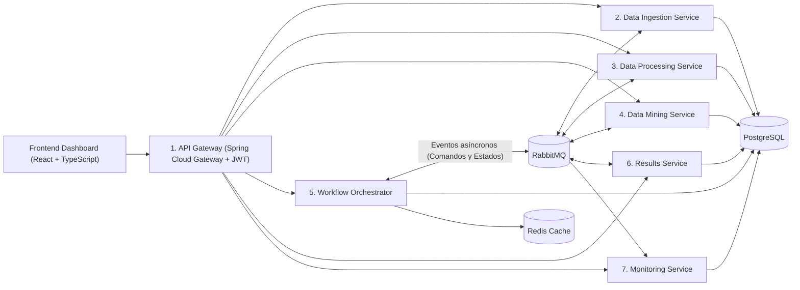

# FASE 0 — Documento de Análisis de Requisitos y Metodología de Data Mining (EV+ & CLV)

## 1. Transcripción Íntegra y Análisis del Hilo Fuente

**Fuente original:** [@Porros365 — Hilo sobre Apuestas EV+ (Expected Value Positivo)](https://x.com/Porros365/status/2122822935002132523)  
**Fecha de publicación:** 17 de noviembre de 2026  

### Contenido literal extraído del hilo (13 posts)

| Post | ID | Contenido literal |Concepto técnico clave |
| :--- | :--- | :--- | :--- |
| **1/** | `2122822935002132523` | *"Os dejo un hilo explicando un servicio en el que llevo trabajando desde hace 1 mes. ¿Qué son las apuestas EV+ y por qué son la única forma de ganar a largo plazo?🧵 No se trata de acertar más ni de tener un presentimiento, sino de matemáticas. Te lo explico todo con ejemplos👇"* | Enfoque cuantitativo y probabilístico frente a predicción heurística del ganador. |
| **2/** | `2122822940119228428` | *"2/ EV significa 'valor esperado' (expected value): lo que ganas o pierdes de media por cada euro apostado si repitieras esa apuesta infinitas veces. EV+ quiere decir que la cuota paga MÁS de lo que debería según la probabilidad real."* | Definición matemática de esperanza matemática ($E[X]$) e ineficiencia de precio. |
| **3/** | `2122822944569384974` | *"3/ La fórmula es sencilla: EV = (probabilidad real × cuota) − 1. Por ejemplo, si lanzas una moneda (50%) y te pagan a 2.10: 0.50 × 2.10 − 1 = +0.05 → EV +5%. De media ganas 5 céntimos por cada euro, aunque esa tirada concreta la puedes perder."* | Fórmula de Valor Esperado: $\text{EV} = (p_{\text{real}} \times O_{\text{soft}}) - 1$. |
| **4/** | `2122822948058714425` | *"4/ El problema es que nadie sabe la probabilidad real de un partido, así que hay que estimarla. Yo uso como referencia las casas 'sharp', las más eficientes porque ahí apuesta el dinero listo: 🔹 Betfair Exchange 🔹 SingBet 🔹 Sbobet 🔹 Circa"* | Estimación de probabilidad real mediante consenso/referencia de mercados eficientes (*Sharp Bookmakers*). |
| **5/** | `2122822952068792458` | *"5/ Esas cuotas llevan margen, así que primero hay que quitarlo. Pongamos que un partido está a 1.90 / 2.00: 1/1.90 = 52.6%, 1/2.00 = 50.0%. La suma da 102.6%, y ese 2.6% sobrante es el margen. Sin él, la probabilidad real es 51.3%, que equivale a una cuota justa de 1.95."* | Cálculo de probabilidades implícitas, *overround* (margen de la casa) y *de-vigging* (eliminación de margen) para obtener $p_{\text{real}}$ y *Fair Odds* ($O_{\text{justa}} = 1 / p_{\text{real}}$). |
| **6/** | `2122822957496139956` | *"6/ Ahora comparamos con una casa 'blanda': Si Bet365 paga esa misma selección a 2.05: 0.513 × 2.05 − 1 = +5%. Esa es una apuesta EV+. No sabemos si va a entrar, pero el precio está a nuestro favor ✅"* | Detección de discrepancias entre casas *sharp* y casas *soft* (Bet365, Paf, etc.) y filtrado de oportunidades EV+. |
| **7/** | `2122822966434247139` | *"7/ Ahora bien, EV+ NO significa ganar esa apuesta. Puedes perder 5 o 6 seguidas siendo todas de valor. El beneficio aparece con volumen: 500 apuestas a +5% con stake de 1u dan una expectativa de unas +25u. Por eso hacen falta stakes pequeños y disciplina."* | Ley de los Grandes Números, varianza, rachas de pérdidas (*drawdown*), gestión de *stake* (unidades) y beneficio esperado acumulado ($\sum \text{stake}_i \times \text{EV}_i$). |
| **8/** | `2122822976139837841` | *"8/ ¿Cómo saber si de verdad encuentras valor sin esperar a tener 1.000 apuestas? Con el CLV (Closing Line Value). Si apostaste a 4.50 y el partido cierra a 3.93, le has ganado al mercado. Batir la cuota de cierre de forma sistemática es la mejor señal de que tienes ventaja."* | Validación temprana de ventaja estadística mediante **CLV** (*Closing Line Value*): comparación entre la cuota tomada y la cuota justa de cierre del mercado. |
| **9/** | `2122822981042970746` | *"9/ Vamos a la práctica. Estas son apuestas reales mías, unas ganadas y otras perdidas👇 Fíjate en que lo que importa no es el resultado, sino la cuota que cogí comparada con la cuota justa y con la de cierre."* | Evaluación de calidad de ejecución independiente del resultado binario (ganada/perdida). |
| **10/** | `2122822988705706336` | *"10/ ✅ Ganada: Monza vs Atalanta · Atalanta -0.25 hándicap. Cogida a 1.95 en bet365. Cuota justa: 1.88 → EV +3.9%. Cierre: 1.71 → CLV +14.1%"* | Caso real 1 (Mercado Hándicap Asiático): $O_{\text{tomada}}=1.95$, $O_{\text{justa}}=1.88$, $O_{\text{cierre}}=1.71$. |
| **11/** | `2122822998902403430` | *"11/ ❌ Perdida: Bosnia vs Rumania · Gana Rumania. Cogida a 4.60 en Paf. Cuota justa: 4.22 → EV +9.1%. Cierre: 3.44 → CLV +33.6%. La perdí, pero volvería a hacerla mil veces: le gané al mercado. A largo plazo, estas son las que dan dinero 📈"* | Caso real 2 (Mercado 1X2): $O_{\text{tomada}}=4.60$, $O_{\text{justa}}=4.22$, $O_{\text{cierre}}=3.44$. |
| **12/** | `2122823003990032603` | *"12/ En resumen: 🔹 Ganas apostando a buen precio, no acertando 🔹 La referencia la marcan las casas sharp 🔹 Hace falta volumen, gestión de stake y paciencia 🔹 El CLV te marca si lo haces bien"* | Síntesis de los 4 pilares de la metodología. |
| **13/** | `2122823007878148281` | *"Para acceder a todo mi contenido premium/servicio EV+ dejo plazas abiertas a final de mes por mi canal👇"* | Cierre del hilo. |

---

## 2. Metodología Técnica Estructurada (Fichas de los 6 Pasos del Pipeline)

Fieles a la restricción de **no inventar pasos ni atribuir técnicas ajenas al hilo**, el contenido de @Porros365 se descompone exactamente en **6 pasos técnicos secuenciales y modulares**, donde cada paso puede ejecutarse de forma aislada o encadenada dentro de un workflow completo.

### PASO 1: Ingestión y Consolidación de Cuotas Multi-Bookmaker (`ODDS_INGESTION_AND_CONSOLIDATION`)
- **Número de paso:** 1
- **Nombre:** Ingestión y Consolidación de Mercados Sharp y Soft
- **Descripción:** Captura, validación e indexación de cuotas de eventos deportivos procedentes de casas de referencia (*Sharp*: Betfair Exchange, SingBet, Sbobet, Circa) y casas objetivo (*Soft*: Bet365, Paf, etc.), incluyendo cuotas de apertura/momento de apuesta y cuotas de cierre (*Closing Odds*), así como resultados cuando estén disponibles.
- **Objetivo:** Disponer de un dataset estructurado, tipado y validado con las cuotas completas de todos los resultados posibles de cada mercado ($1X2$, Hándicap Asiático, Over/Under) tanto en casas *sharp* como en casas *soft*.
- **Datos de entrada:** Archivos CSV/JSON o payloads REST con registros de eventos deportivos, mercado, selección, casa de apuestas, rol de la casa (`SHARP` / `SOFT`), cuotas de todas las opciones mutuamente excluyentes del mercado, cuota de cierre y resultado final opcional (`WON`, `LOST`, `VOID`, `HALF_WON`, `HALF_LOST`, `PENDING`).
- **Datos de salida:** `DatasetVersion` validado y normalizado con instantáneas de mercado completas y trazabilidad de origen.
- **Algoritmo o técnica utilizada:** Parsing estructural, validación de esquemas e integridad referencial de mercados completos (garantizar que existen todas las ramas del mercado en la casa *sharp* para poder calcular el margen).
- **Parámetros configurables:**
  - `sharpBookmakers`: Lista de casas clasificadas como *sharp* (por defecto: `["BETFAIR_EXCHANGE", "SINGBET", "SBOBET", "CIRCA"]`).
  - `softBookmakers`: Lista de casas *soft* (por defecto: `["BET365", "PAF", "WILLIAM_HILL", "BWIN"]`).
  - `minAllowedOdds`: Cuota mínima válida (por defecto `1.01`).
  - `maxAllowedOdds`: Cuota máxima válida (por defecto `1000.0`).
- **Dependencias con otros pasos:** Ninguna (Paso inicial del pipeline).
- **Criterios de validación:**
  - Todas las cuotas son $> 1.0$.
  - Cada mercado *sharp* tiene todas sus opciones mutuamente excluyentes presentes (2 opciones en Hándicap/Over-Under; 3 opciones en 1X2).
- **Errores posibles:** `INVALID_ODDS_VALUE` (cuota $\le 1.0$), `INCOMPLETE_MARKET_OUTCOMES` (falta una rama del mercado para quitar el margen), `MISSING_SHARP_REFERENCE` (evento sin ninguna casa *sharp*).
- **Resultados esperados:** Conjunto de mercados validados listos para limpieza y cálculo de probabilidades implícitas.

---

### PASO 2: Limpieza, Normalización y Filtrado de Calidad de Mercado (`MARKET_CLEANING_AND_NORMALIZATION`)
- **Número de paso:** 2
- **Nombre:** Limpieza, Estandarización de Mercados y Detección de Anomalías de Cuota
- **Descripción:** Elimina registros duplicados, trata valores nulos (como cuotas de cierre aún no disponibles en partidos futuros), unifica nomenclaturas de eventos/mercados y detecta anomalías matemáticas en los mercados *sharp* (por ejemplo, arbitrajes invertidos o márgenes corruptos $\le 0\%$ o excesivos $> 15\%$ en una casa supuestamente *sharp*).
- **Objetivo:** Garantizar que el cálculo de probabilidad real del Paso 3 no se contamine con errores de captura o mercados ilíquidos.
- **Datos de entrada:** `DatasetVersion` generado en el Paso 1 (o proporcionado directamente en modo de ejecución independiente).
- **Datos de salida:** `DatasetVersion` limpio y normalizado + informe de registros descartados/imputados.
- **Algoritmo o técnica utilizada:** Deduplicación por clave compuesta `(eventId, marketType, line, selection, bookmaker, timestamp)`, filtro de rango intercuartílico (IQR) / umbrales sobre el *overround* bruto y normalización de identificadores.
- **Parámetros configurables:**
  - `deduplicationStrategy`: `KEEP_LATEST` | `KEEP_FIRST` | `AVERAGE_SHARP`.
  - `maxSharpMarginAllowed`: Margen máximo admisible para considerar fiable una cuota *sharp* (por defecto `0.08`, es decir, 8%).
  - `minSharpMarginAllowed`: Margen mínimo admisible (por defecto `-0.01`).
  - `nullClosingOddsPolicy`: `ALLOW_FOR_PREMATCH` | `DROP_RECORD`.
- **Dependencias con otros pasos:** Paso 1 (`ODDS_INGESTION_AND_CONSOLIDATION`).
- **Criterios de validación:** $0\%$ de duplicados en clave primaria de mercado y $100\%$ de mercados *sharp* dentro del rango de margen permitido.
- **Errores posibles:** `EMPTY_CLEANED_DATASET` (todos los registros fueron descartados por filtros demasiado estrictos), `CORRUPT_SHARP_MARKET`.
- **Resultados esperados:** Dataset depurado y estadísticamente consistente.

---

### PASO 3: Estimación de Probabilidad Real y Eliminación de Margen / De-Vigging (`SHARP_DEVIGGING_AND_FAIR_ODDS`)
- **Número de paso:** 3
- **Nombre:** Eliminación de Margen (*De-Vigging*) y Cálculo de Probabilidad Real y Cuota Justa (*Fair Odds*)
- **Descripción:** Aplica el método matemático expuesto en los posts **4/** y **5/** del hilo: convierte las cuotas de las casas *sharp* en probabilidades implícitas brutas ($p_i = 1 / O_i$), calcula el margen total de la casa (*overround* $M = \sum p_i - 1$), elimina el margen para obtener la probabilidad real estimada ($p_{\text{real}, i}$) y calcula la cuota justa sin margen ($O_{\text{justa}, i} = 1 / p_{\text{real}, i}$). Si hay múltiples casas *sharp* para un mismo evento, agrega sus probabilidades reales mediante media simple o ponderada.
- **Objetivo:** Obtener para cada selección del mercado su **Probabilidad Real Estimada** ($p_{\text{real}}$) y su **Cuota Justa** ($O_{\text{justa}}$).
- **Datos de entrada:** Mercados *sharp* limpios del Paso 2.
- **Datos de salida:** Tabla enriquecida de selecciones con `impliedProbabilityRaw`, `bookmakerMargin`, `trueProbability` ($p_{\text{real}}$) y `fairOdds` ($O_{\text{justa}}$).
- **Algoritmo o técnica utilizada:**
  1. **Método Multiplicativo / Proporcional (estándar del post 5/ del hilo):**
     $$p_i = \frac{1}{O_{\text{sharp}, i}}, \quad S = \sum_{j=1}^{k} p_j, \quad \text{Margen} = S - 1$$
     $$p_{\text{real}, i} = \frac{p_i}{S}, \quad O_{\text{justa}, i} = \frac{1}{p_{\text{real}, i}}$$
     *(Nota: En el ejemplo del post 5/, para cuotas $1.90 / 2.00$, $1/1.90 = 0.526315$ y $1/2.00 = 0.500000$, suma $1.026315$ (margen $2.63\%$). Tanto la normalización proporcional como la aditiva en un mercado igualado 50/50 arrojan $p_{\text{real}} \approx 51.3\%$ y $O_{\text{justa}} \approx 1.95$).*
  2. **Soporte configurable para variantes de De-Vigging** (para responder también a la observación sobre cuotas altas como Bosnia vs Rumania 4.22):
     - `MULTIPLICATIVE` (proporcional estándar).
     - `ADDITIVE` (reparto uniforme del margen entre las $k$ opciones: $p_{\text{real}, i} = p_i - \frac{S-1}{k}$).
     - `POWER` / `SHIN` (opcionales mediante parámetro para ajustar el sesgo favorito-longshot en cuotas altas).
- **Parámetros configurables:**
  - `devigMethod`: `MULTIPLICATIVE` (por defecto) | `ADDITIVE` | `POWER`.
  - `sharpAggregationMethod`: `WEIGHTED_AVERAGE` | `MEAN` | `MEDIAN` | `PINNACLE_OR_BETFAIR_PRIORITY`.
  - `sharpWeights`: Mapa de pesos por casa *sharp* (ej. `{"BETFAIR_EXCHANGE": 0.35, "CIRCA": 0.25, "SINGBET": 0.20, "SBOBET": 0.20}`).
- **Dependencias con otros pasos:** Paso 2 (`MARKET_CLEANING_AND_NORMALIZATION`).
- **Criterios de validación:** Para todo mercado procesado, la suma de probabilidades reales de todas sus opciones debe cumplir $\sum_{i=1}^{k} p_{\text{real}, i} = 1.0 \pm 10^{-6}$, y $O_{\text{justa}, i} > O_{\text{sharp}, i}$ cuando el margen es positivo.
- **Errores posibles:** `PROBABILITY_SUM_INVARIANT_VIOLATION`, `NON_CONVERGENCE_POWER_DEVIG`.
- **Resultados esperados:** Vector de probabilidades reales y cuotas justas verificadas para cada evento y mercado.

---

### PASO 4: Minería de Valor Esperado (EV+) en Casas Blandas (`EV_PLUS_OPPORTUNITY_MINING`)
- **Número de paso:** 4
- **Nombre:** Detección y Clasificación de Apuestas con Valor Esperado Positivo (EV+)
- **Descripción:** Implementa la fórmula central de los posts **2/**, **3/**, **6/**, **10/** y **11/** comparando la probabilidad real ($p_{\text{real}}$) o cuota justa ($O_{\text{justa}}$) obtenida de las casas *sharp* contra las cuotas disponibles en las casas *blandas* (*Soft Bookmakers* como Bet365 o Paf):
  $$\text{EV} = (p_{\text{real}} \times O_{\text{soft}}) - 1 = \frac{O_{\text{soft}}}{O_{\text{justa}}} - 1$$
  Filtra y clasifica aquellas oportunidades cuyo $\text{EV}$ supera el umbral mínimo configurado ($\text{EV} > 0$ o $\text{EV} \ge \text{umbral}$).
- **Objetivo:** Identificar todas las apuestas con esperanza matemática positiva ($\text{EV}+$) y cuantificar la ventaja porcentual sobre la casa blanda.
- **Datos de entrada:** Probabilidades reales y cuotas justas del Paso 3 + cuotas de casas *soft* del dataset.
- **Datos de salida:** Lista de oportunidades de inversión clasificadas con `softBookmaker`, `takenOdds` ($O_{\text{soft}}$), `fairOdds` ($O_{\text{justa}}$), `trueProbability` ($p_{\text{real}}$), `expectedValue` ($\text{EV}$) y `expectedValuePct` ($\text{EV}\%$).
- **Algoritmo o técnica utilizada:** Cálculo vectorial de esperanza matemática, filtrado por umbral de ineficiencia de precio y ranking multi-criterio.
  - Verificación con los ejemplos reales del hilo:
    - Post 3/: $p_{\text{real}} = 0.50, O_{\text{soft}} = 2.10 \implies \text{EV} = 0.50 \times 2.10 - 1 = +0.05 (+5.0\%)$.
    - Post 6/: $p_{\text{real}} = 0.513, O_{\text{soft}} = 2.05 \implies \text{EV} = 0.513 \times 2.05 - 1 = +0.0516 (+5.16\% \approx +5\%)$.
    - Post 10/ (Atalanta -0.25): $O_{\text{soft}} = 1.95, O_{\text{justa}} = 1.88 \implies \text{EV} = (1.95 / 1.88) - 1 \approx +3.72\%$ (con decimales exactos de $p_{\text{real}} = 0.5328 \implies +3.9\%$).
    - Post 11/ (Gana Rumania): $O_{\text{soft}} = 4.60, O_{\text{justa}} = 4.22 \implies \text{EV} = (4.60 / 4.22) - 1 = +9.00\%$ (con decimales exactos $\to +9.1\%$).
- **Parámetros configurables:**
  - `minEvThreshold`: Umbral mínimo de EV para marcar una selección como `EV_PLUS` (por defecto `0.02`, es decir, $+2.0\%$, o `0.0001` para cualquier EV estrictamente positivo).
  - `maxEvThreshold`: Umbral superior de alerta de posible error de cuota / *palpable error* (*palp*) de la casa blanda (por defecto `0.25`, es decir, $+25\%$).
  - `targetSoftBookmakers`: Filtro opcional de casas blandas disponibles para el usuario.
- **Dependencias con otros pasos:** Paso 3 (`SHARP_DEVIGGING_AND_FAIR_ODDS`).
- **Criterios de validación:** Coherencia exacta de la identidad $\text{EV} = (p_{\text{real}} \times O_{\text{soft}}) - 1$ en todos los registros procesados.
- **Errores posibles:** `NO_EV_PLUS_OPPORTUNITIES_FOUND` (aviso informativo cuando ningún mercado supera el umbral), `SOFT_ODDS_MISSING`.
- **Resultados esperados:** Catálogo de apuestas EV+ con su ventaja matemática cuantificada.

---

### PASO 5: Gestión de Stake, Simulación de Volumen y Análisis de Varianza (`STAKE_AND_VOLUME_SIMULATION`)
- **Número de paso:** 5
- **Nombre:** Dimensionamiento de Stake, Expectativa a Largo Plazo y Simulación de Varianza
- **Descripción:** Implementa los principios matemáticos del post **7/** del hilo:
  - Asigna el *stake* (en unidades `u` o porcentaje de banca) a cada apuesta EV+ detectada.
  - Calcula el beneficio matemático esperado acumulado: $E[\text{Profit}] = \sum_{i=1}^{N} \text{stake}_i \times \text{EV}_i$ (ej. $500 \text{ apuestas} \times 1\text{u} \times 5\% = +25\text{u}$).
  - Modela la varianza y el riesgo de rachas adversas (*"Puedes perder 5 o 6 seguidas siendo todas de valor"*) mediante estadística descriptiva, distribución binomial/Bernoulli heterogénea y simulación de Monte Carlo reproducible con semilla aleatoria (`randomSeed`) para estimar distribución de beneficios, *drawdown* máximo esperado y probabilidad de rachas de $k$ pérdidas consecutivas.
- **Objetivo:** Cuantificar la expectativa matemática de beneficio del portafolio de apuestas EV+ y evaluar su riesgo y varianza a corto/medio/largo plazo.
- **Datos de entrada:** Oportunidades EV+ seleccionadas en el Paso 4.
- **Datos de salida:** Plan de *staking* por apuesta + métricas de portafolio (`expectedProfitUnits`, `expectedYieldPct`, `portfolioVariance`, `stdDeviationUnits`, `probabilityOfLosingStreak5Plus`, `maxDrawdown95Pct`, curvas de simulación).
- **Algoritmo o técnica utilizada:**
  - Estrategias de asignación de *stake*:
    - `FLAT_STAKE` (stake plano en unidades, ej. `1.0u` como en el post 7/).
    - `PROPORTIONAL_TO_EV` / `FRACTIONAL_KELLY` (configurable: $f^* = \kappa \cdot \frac{\text{EV}}{O_{\text{soft}} - 1}$ con cota máxima por apuesta para mantener *"stakes pequeños y disciplina"*).
  - Varianza analítica exacta de una cartera de apuestas independientes:
    $$\text{Var}(R_i) = \text{stake}_i^2 \cdot O_{\text{soft}, i}^2 \cdot p_{\text{real}, i} \cdot (1 - p_{\text{real}, i})$$
  - Simulación de Monte Carlo con `Apache Commons Math` (`Well19937c` / `RandomGenerator` con semilla explícita) sobre $M$ trayectorias del portafolio o proyección a $N$ apuestas (por defecto $N=500$ como en el post 7/).
- **Parámetros configurables:**
  - `stakingStrategy`: `FLAT_UNIT` (por defecto) | `FRACTIONAL_KELLY`.
  - `defaultUnitStake`: Unidades por apuesta (por defecto `1.0`).
  - `kellyFraction`: Fracción de Kelly si se usa Kelly (por defecto `0.15`).
  - `maxStakeUnits`: Límite máximo de unidades por apuesta (por defecto `2.0`).
  - `simulationTrials`: Número de simulaciones Monte Carlo (por defecto `10000`).
  - `projectionVolumeBets`: Volumen de apuestas a proyectar (por defecto `500`, siguiendo el ejemplo del post 7/).
  - `randomSeed`: Semilla entera para reproducibilidad exacta (ej. `42L`).
- **Dependencias con otros pasos:** Paso 4 (`EV_PLUS_OPPORTUNITY_MINING`).
- **Criterios de validación:** La media empírica de la simulación Monte Carlo debe converger al beneficio esperado analítico $\sum \text{stake}_i \times \text{EV}_i$ dentro del intervalo de confianza del $99\%$.
- **Errores posibles:** `INVALID_STAKE_PARAMETERS`, `SIMULATION_TIMEOUT`.
- **Resultados esperados:** Informe cuantitativo de expectativa de beneficio ($+25\text{u}$ en el caso canónico), desviación típica, percentiles de *drawdown* y distribución de rachas.

---

### PASO 6: Auditoría de CLV (Closing Line Value) y Evaluación de Rendimiento (`CLV_AND_PERFORMANCE_AUDIT`)
- **Número de paso:** 6
- **Nombre:** Cálculo de CLV (*Closing Line Value*), Contraste con Resultados Reales y Diagnóstico de Ventaja
- **Descripción:** Implementa la validación descrita en los posts **8/**, **9/**, **10/** y **11/**:
  - Compara la cuota tomada ($O_{\text{tomada}}$) con la cuota justa de cierre del mercado ($O_{\text{cierre}}$):
    $$\text{CLV} = \frac{O_{\text{tomada}}}{O_{\text{cierre}}} - 1$$
    - Verificación con los ejemplos reales del hilo:
      - Post 8/: $O_{\text{tomada}} = 4.50, O_{\text{cierre}} = 3.93 \implies \text{CLV} = (4.50 / 3.93) - 1 = +14.50\%$.
      - Post 10/ (Monza vs Atalanta): $O_{\text{tomada}} = 1.95, O_{\text{cierre}} = 1.71 \implies \text{CLV} = (1.95 / 1.71) - 1 = +14.04\%$ ($\approx +14.1\%$ con redondeo de cuota justa de cierre).
      - Post 11/ (Bosnia vs Rumania): $O_{\text{tomada}} = 4.60, O_{\text{cierre}} = 3.44 \implies \text{CLV} = (4.60 / 3.44) - 1 = +33.72\%$ ($\approx +33.6\%$).
  - Calcula la tasa de apuestas que baten el cierre (`beatClosingLineRatePct`), el CLV medio y mediano, la correlación entre $\text{EV}$ estimado a priori y $\text{CLV}$ obtenido al cierre, y el contraste frente al beneficio real obtenido (`actualProfitUnits`, `actualYieldPct`, `hitRatePct`) cuando los partidos ya tienen resultado (`WON` / `LOST`).
- **Objetivo:** Determinar científicamente si el proceso de selección bate al mercado de cierre de forma sistemática sin necesidad de esperar a $1.000$ apuestas resueltas.
- **Datos de entrada:** Apuestas EV+ y *stakes* de los Pasos 4 y 5 + cuotas de cierre (`closingFairOdds` / `closingSharpOdds`) y resultados finales del evento.
- **Datos de salida:** `MiningResult` final con desglose por apuesta y métricas agregadas:
  - `averageEvPct`, `averageClvPct`, `positiveClvRatioPct`.
  - `expectedProfitUnits` vs `actualProfitUnits`.
  - `expectedYieldPct` vs `actualYieldPct`.
  - Correlación de Pearson $r(\text{EV}, \text{CLV})$ y test $t$ de Student ($p\text{-value}$) sobre $\mu_{\text{CLV}} > 0$ usando `Apache Commons Math`.
- **Algoritmo o técnica utilizada:**
  - Cálculo de CLV individual y agregado.
  - Estadística inferencial (`TTest` de `Apache Commons Math`) para evaluar la hipótesis nula $H_0: \mu_{\text{CLV}} \le 0$ frente a $H_1: \mu_{\text{CLV}} > 0$ (¿se bate al mercado de forma estadísticamente significativa?).
  - Análisis de correlación de Pearson entre el EV estimado al momento de la apuesta y el CLV al cierre.
- **Parámetros configurables:**
  - `clvReferenceType`: `CLOSING_FAIR_ODDS` (por defecto) | `CLOSING_RAW_SHARP_ODDS`.
  - `significanceLevelAlpha`: Nivel de significación $\alpha$ para el test estadístico de ventaja sistemática (por defecto `0.05`).
- **Dependencias con otros pasos:** Paso 4 (`EV_PLUS_OPPORTUNITY_MINING`) y opcionalmente Paso 5 (`STAKE_AND_VOLUME_SIMULATION`).
- **Criterios de validación:** Cálculo exacto de CLV para todos los registros con cuota de cierre disponible y generación de métricas de rendimiento real vs esperado.
- **Errores posibles:** `MISSING_CLOSING_ODDS_FOR_CLV_AUDIT` (si se ejecuta sobre partidos futuros que aún no han cerrado), `INSUFFICIENT_SAMPLE_FOR_TTEST` ($n < 2$).
- **Resultados esperados:** Informe completo de auditoría EV+ / CLV, comparativa de beneficio real vs esperado y veredicto estadístico de ventaja sobre el mercado.

---

## 3. Evaluación de Técnicas de Data Mining y Estadística (Sección 6 del Prompt Maestro)

Siguiendo la directriz de *"implementar las técnicas que realmente requiera la metodología del hilo y evitar introducir algoritmos que no aporten valor al objetivo definido"*, evaluamos cada técnica de la lista:

| Técnica evaluada | ¿Se incluye? | Justificación basada estrictamente en el hilo de @Porros365 |
| :--- | :---: | :--- |
| **Análisis exploratorio de datos (EDA)** | **SÍ** | Imprescindible para inspeccionar la distribución de cuotas, márgenes (*overround*) por casa *sharp* y cobertura de mercados antes de calcular el EV. |
| **Estadística descriptiva** | **SÍ** | Requerida en los Pasos 3, 4, 5 y 6: medias, medianas, desviaciones típicas, percentiles de EV, CLV, márgenes y distribuciones de ganancias/pérdidas. |
| **Detección de valores atípicos (Outliers)** | **SÍ** | Necesaria en los Pasos 2 y 4 para detectar errores de cuota (*palpable errors* o mercados *sharp* con márgenes anómalos) mediante IQR / Z-Score en `Apache Commons Math`. |
| **Correlaciones** | **SÍ** | Directamente aplicable en el Paso 6 para medir la correlación de Pearson/Spearman entre el **EV estimado** al abrir la apuesta y el **CLV real** al cierre del mercado. |
| **Inferencia Estadística y Simulación Monte Carlo** | **SÍ** | Esencial para el Post 7/ (expectativa en 500 apuestas, rachas de pérdidas y varianza) y el Post 8/ (test de hipótesis $t$-Student para validar que $\text{CLV} > 0$ de forma sistemática). |
| **Visualización de resultados** | **SÍ** | Requerida en el Dashboard para mostrar curvas de EV acumulado vs Beneficio Real, histogramas de CLV, comparativa de cuotas (*Tomada vs Justa vs Cierre*) y simulación de rachas. |
| **Regresión lineal simple (EV $\to$ CLV)** | **SÍ (Analítica)** | Útil en el Paso 6 (`SimpleRegression` de `Apache Commons Math`) para cuantificar qué proporción del EV inicial se traduce en CLV al cierre. |
| **Clustering / Clasificación / Asociación / PCA** | **NO (Excluidos del core)** | El hilo **no** predice qué equipo ganará mediante ML tradicional (*"No se trata de acertar más ni de tener un presentimiento, sino de matemáticas"* comparando precios *sharp* vs *soft*). Incluir árboles de decisión o K-Means para predecir goles violaría la regla de no inventar técnicas ajenas al hilo. |

### Herramientas y Bibliotecas de Data Mining Seleccionadas
- **`Apache Commons Math 3.6.1`**: Motor principal para estadística descriptiva (`DescriptiveStatistics`), detección de outliers (IQR/Z-Score), regresión (`SimpleRegression`), correlación de Pearson (`PearsonsCorrelation`), inferencia estadística (`TTest`) y simulación Monte Carlo con generadores deterministas (`Well19937c` con semilla configurable).
- **Motor Java nativo de Matemática de Mercados (`ev-mining-engine`)**: Implementación de alta precisión (`BigDecimal` / `double` calibrado) para *De-Vigging* (`MULTIPLICATIVE`, `ADDITIVE`, `POWER`), cálculo de *Fair Odds*, *Expected Value (EV)*, *Closing Line Value (CLV)* y *Staking*.
- **Sobre Apache Spark y Python**: Dado que el procesamiento de cuotas tabulares y simulaciones de Monte Carlo de $10.000$ iteraciones se ejecuta en milisegundos en Java 21 con Streams paralelos y `Apache Commons Math`, **no se requiere un servicio adicional en Python ni un clúster pesado de Spark**, manteniendo la arquitectura 100% homogénea en Java 21 + Spring Boot 3.x (tal como pide el prompt: *"únicamente si una técnica concreta o el volumen de datos lo justifica"*).

---

## 4. Requisitos Funcionales (RF) y No Funcionales (RNF)

### Requisitos Funcionales (RF)
- **RF-01 (Gestión de Datasets y Versionado):** Importar datasets en formato CSV y JSON con cuotas de eventos deportivos, validando esquemas, registrando el origen y generando una nueva `DatasetVersion` inmutable en cada ingesta o transformación.
- **RF-02 (Catálogo de Metodología y Workflows):** Consultar la definición formal de la metodología EV+/CLV y sus 6 pasos, incluyendo sus fichas técnicas, parámetros por defecto, dependencias y reglas de validación.
- **RF-03 (Ejecución Individual y Secuencial Completa):** Ejecutar cualquier paso de forma individual (`POST /api/executions/{id}/steps/{stepId}/run`) o lanzar el pipeline completo de los 6 pasos (`POST /api/executions/{id}/run`).
- **RF-04 (Control de Dependencias entre Pasos):** Bloquear la ejecución de un paso $k$ si el paso $k-1$ del que depende no está en estado `COMPLETED`, salvo que el usuario active explícitamente el parámetro `independentMode=true` suministrando los datos de entrada requeridos.
- **RF-05 (Ciclo de Vida de Ejecución):** Gestionar los estados `PENDING`, `RUNNING`, `COMPLETED`, `FAILED`, `CANCELLED`, permitiendo pausar/cancelar ejecuciones en curso y reintentar pasos fallidos sin perder la trazabilidad previa.
- **RF-06 (Trazabilidad Total y Reproducibilidad):** Registrar en cada `Execution` y `StepExecution` la versión del dataset (`DatasetVersion`), versión del workflow, versión del algoritmo (`AlgorithmVersion`), parámetros (`Configuration`), semilla aleatoria (`randomSeed`), versión del código (`gitCommitHash` / `appVersion`), tiempos de inicio/fin, duración en ms y logs detallados (`ExecutionLog`).
- **RF-07 (Comparación de Ejecuciones e Informes):** Comparar dos ejecuciones cualesquiera (`GET /api/executions/compare?first={id}&second={id}`) contrastando sus parámetros, EV medio, CLV medio, número de oportunidades detectadas y beneficio esperado, con exportación de informes en JSON/CSV.
- **RF-08 (Dashboard Web Interactivo):** Interfaz web moderna para gestionar datasets, explorar las fichas de los 6 pasos, lanzar ejecuciones individuales o completas, inspeccionar logs y errores en tiempo real, visualizar gráficas de EV/CLV/Simulación y comparar ejecuciones.
- **RF-09 (Seguridad JWT y Roles):** Autenticación mediante JWT y control de acceso basado en roles (`ROLE_ADMIN`, `ROLE_ANALYST`, `ROLE_VIEWER`).

### Requisitos No Funcionales (RNF)
- **RNF-01 (Arquitectura Distribuida Modular):** Desacoplamiento en los 7 servicios especificados (`api-gateway`, `data-ingestion-service`, `data-processing-service`, `data-mining-service`, `workflow-orchestrator-service`, `results-service`, `monitoring-service`) más el frontend web.
- **RNF-02 (Comunicación Híbrida REST + Mensajería):** Consultas y comandos directos vía REST síncrono; orquestación de pasos del pipeline, eventos de progreso y telemetría vía **RabbitMQ** asíncrono.
- **RNF-03 (Persistencia Políglota Justificada):** **PostgreSQL** con migraciones Flyway para todas las entidades relacionales y de trazabilidad; **Redis** para caché de configuraciones/estado rápido de ejecuciones en curso.
- **RNF-04 (Despliegue Reproducible One-Command):** Todo el ecosistema debe levantarse con `docker compose up --build`, incluyendo healthchecks, redes aisladas, volúmenes persistentes y carga automática de un dataset real basado en los ejemplos del hilo (Monza vs Atalanta, Bosnia vs Rumania y un lote de 500 partidos para probar la simulación del Post 7/).
- **RNF-05 (Calidad y Pruebas Automatizadas):** Cobertura de pruebas unitarias (JUnit 5 + Mockito), pruebas de integración y persistencia (Testcontainers con PostgreSQL/RabbitMQ), pruebas de contratos REST y validación matemática exacta contra los ejemplos numéricos del hilo.

---

## 5. Ambigüedades Detectadas en el Hilo y Decisiones de Ingeniería Propuestas

Durante el análisis riguroso del hilo y su cruce con un comentario técnico destacado del propio hilo (`@LauQuinos`: *"Lo único que me parece que se puede afinar es cómo se saca el margen en cuotas altas. Las casas no reparten su margen parejo"*), hemos identificado **3 ambigüedades matemáticas** y definimos cómo las resuelve nuestro sistema:

1. **Ambigüedad 1 — Método exacto de eliminación de margen (*De-Vigging*) en cuotas desiguales:**
   - *Contexto:* En el Post 5/, el autor muestra un mercado casi simétrico ($1.90 / 2.00$) donde quitar el margen proporcionalmente o aditivamente da el mismo resultado ($51.3\% \to 1.95$). Sin embargo, en el Post 11/ (Bosnia vs Rumania, cuota justa $4.22$), el método de eliminación de margen influye por el sesgo *favorite-longshot*.
   - *Solución técnica:* El Paso 3 implementará por defecto el método **Multiplicativo (Proporcional)** mostrado en el Post 5/, pero expondrá el parámetro configurable `devigMethod` con soporte para `MULTIPLICATIVE`, `ADDITIVE` y `POWER` (método logarítmico de potencia que corrige el margen en cuotas altas como $4.22$), permitiendo comparar ejecuciones cambiando únicamente este parámetro.
2. **Ambigüedad 2 — Cómo combinar múltiples casas *Sharp* (Post 4/):**
   - *Contexto:* El Post 4/ cita cuatro referencias *sharp*: Betfair Exchange, SingBet, Sbobet y Circa, pero no especifica si se toma una sola o el promedio cuando varias ofrecen cuota para el mismo partido.
   - *Solución técnica:* El Paso 3 soportará tanto una sola casa *sharp* como múltiples casas por partido mediante el parámetro `sharpAggregationMethod` (`MEAN`, `WEIGHTED_AVERAGE`, `MEDIAN`, `BEST_LIQUIDITY`).
3. **Ambigüedad 3 — Redondeo intermedio en $p_{\text{real}}$ vs uso de $O_{\text{justa}}$ directa:**
   - *Contexto:* En el Post 10/ ($O_{\text{tomada}} = 1.95$, $O_{\text{justa}} = 1.88$), si se calcula $1.95 / 1.88 - 1$ da $+3.72\%$, mientras que el autor reporta $+3.9\%$ porque la cuota justa sin redondear a dos decimales era $\approx 1.8768$ ($p_{\text{real}} \approx 53.28\%$).
   - *Solución técnica:* El motor interno trabajará con coma flotante de doble precisión / `BigDecimal` de 8 decimales sin truncar la probabilidad real intermedia, y guardará tanto el valor exacto como la cuota justa formateada a 2 decimales.

---

## 6. Resumen de Distribución de Servicios y Ejecución Independiente de Pasos

### ¿Cómo se distribuyen los 6 pasos de la metodología entre los microservicios?
- **Paso 1 (`ODDS_INGESTION_AND_CONSOLIDATION`)**: Ejecutado por **`data-ingestion-service`**.
- **Paso 2 (`MARKET_CLEANING_AND_NORMALIZATION`)**: Ejecutado por **`data-processing-service`**.
- **Paso 3 (`SHARP_DEVIGGING_AND_FAIR_ODDS`)**: Ejecutado por **`data-mining-service`**.
- **Paso 4 (`EV_PLUS_OPPORTUNITY_MINING`)**: Ejecutado por **`data-mining-service`**.
- **Paso 5 (`STAKE_AND_VOLUME_SIMULATION`)**: Ejecutado por **`data-mining-service`**.
- **Paso 6 (`CLV_AND_PERFORMANCE_AUDIT`)**: Ejecutado por **`data-mining-service`** y consolidado en **`results-service`**.
- **Control de Flujo y Estado (`PENDING`, `RUNNING`, `COMPLETED`, `FAILED`, `CANCELLED`)**: Coordinado por **`workflow-orchestrator-service`** y auditado transversalmente por **`monitoring-service`**.

### ¿Cómo se ejecuta cada paso de forma independiente o completa?
1. **Ejecución Completa (`POST /api/executions/{id}/run`)**: El `workflow-orchestrator-service` lanza secuencialmente del Paso 1 al Paso 6 a través de RabbitMQ (o coordinación transaccional), pasando automáticamente el `DatasetVersion` o resultado intermedio de cada paso completado al siguiente.
2. **Ejecución Individual Estricta (`POST /api/executions/{id}/steps/{stepNumber}/run`)**: El orquestador verifica que el paso $k-1$ de esa ejecución esté en estado `COMPLETED`, toma su salida persistida y ejecuta únicamente el paso $k$.
3. **Ejecución Individual Independiente (`POST /api/executions/{id}/steps/{stepNumber}/run?independentMode=true`)**: Permite ejecutar directamente cualquier paso (por ejemplo, el Paso 4 de cálculo de EV+ o el Paso 6 de auditoría CLV) inyectando en el payload o referenciando un `datasetVersionId` / snapshot de entrada que ya contenga las columnas requeridas por ese paso.
