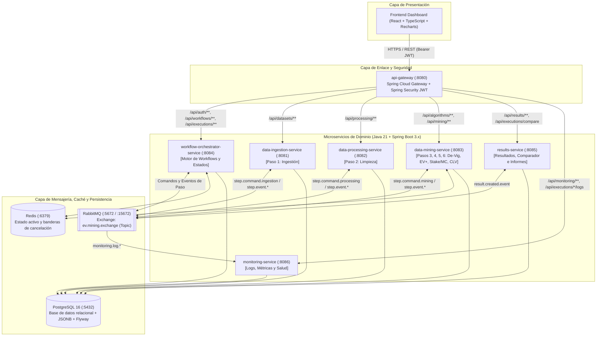
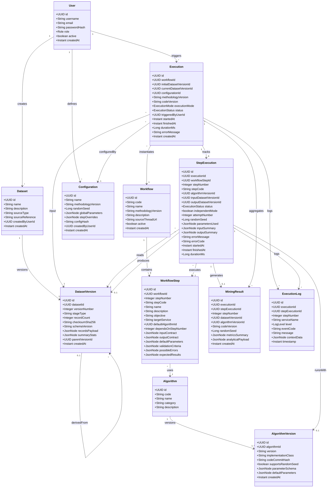
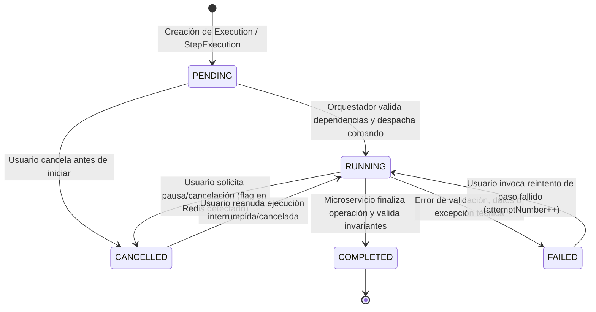
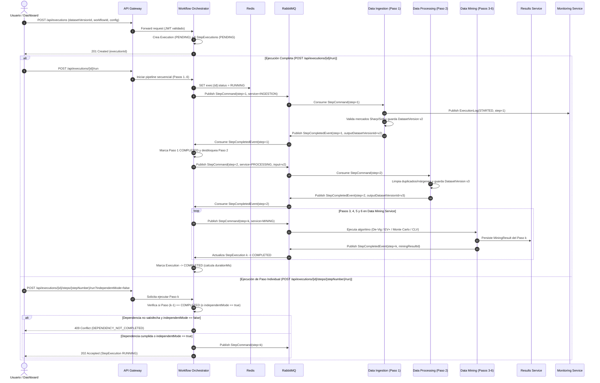

# FASE 1 — Documento de Diseño de Arquitectura, UML, Base de Datos y Contratos

## 1. Arquitectura del Sistema Distribuido

El sistema sigue un patrón de **Microservicios Orientados a Eventos y Orquestación (Saga / Command-Event Orchestration)** sobre **Java 21** y **Spring Boot 3.3.x**, combinando:
- **Comunicación síncrona (REST / HTTP+JSON):** para consultas desde el Dashboard, operaciones CRUD de datasets, inspección de la metodología, disparo de ejecuciones y comparación de resultados.
- **Comunicación asíncrona (RabbitMQ / AMQP 0-9-1):** para el despacho de comandos de ejecución de cada paso (`step.execution.command.<service>`), recepción de eventos de cambio de estado (`step.execution.event.status`) y emisión de telemetría y logs distribuidos (`monitoring.log.event`).

### 1.1 Catálogo de Microservicios y Puertos

| # | Servicio | Artefacto Maven | Puerto | Responsabilidad Principal y Pasos Asignados | Escalabilidad Horizontal |
| :-: | :--- | :--- | :-: | :--- | :--- |
| 1 | **API Gateway** | `api-gateway` | `8080` | Punto de entrada único (Spring Cloud Gateway), validación de JWT, propagación de `X-Correlation-Id` y usuario autenticado, CORS y enrutamiento a microservicios. | Stateless (N réplicas) |
| 2 | **Data Ingestion Service** | `data-ingestion-service` | `8081` | **Paso 1 (`ODDS_INGESTION_AND_CONSOLIDATION`)**: Importación de CSV/JSON, validación estructural de mercados *Sharp* y *Soft*, creación de `Dataset` y `DatasetVersion`. | Stateless + Workers AMQP |
| 3 | **Data Processing Service** | `data-processing-service` | `8082` | **Paso 2 (`MARKET_CLEANING_AND_NORMALIZATION`)**: Deduplicación, tratamiento de nulos, normalización de mercados y filtrado de anomalías de margen *sharp*. | Stateless + Workers AMQP |
| 4 | **Data Mining Service** | `data-mining-service` | `8083` | **Pasos 3, 4, 5 y 6 (`SHARP_DEVIGGING_AND_FAIR_ODDS`, `EV_PLUS_OPPORTUNITY_MINING`, `STAKE_AND_VOLUME_SIMULATION`, `CLV_AND_PERFORMANCE_AUDIT`)**: Catálogo de `Algorithm` y `AlgorithmVersion`, motor matemático EV+/CLV y simulaciones Monte Carlo con `Apache Commons Math`. | Alta (CPU-bound, N réplicas consumidoras de cola `mining.steps.queue`) |
| 5 | **Workflow Orchestrator** | `workflow-orchestrator-service` | `8084` | Gestión de `Workflow`, `WorkflowStep`, `Configuration`, `Execution` y `StepExecution`. Máquina de estados (`PENDING`, `RUNNING`, `COMPLETED`, `FAILED`, `CANCELLED`), control de dependencias entre pasos, modo independiente, pausa/cancelación y reintentos. | Coordinado con bloqueo optimista JPA + caché de estado en Redis |
| 6 | **Results Service** | `results-service` | `8085` | Persistencia y consulta de `MiningResult`, comparador diferencial entre ejecuciones (`/api/executions/compare`), generación de informes y exportación CSV/JSON. | Stateless (N réplicas) |
| 7 | **Monitoring Service** | `monitoring-service` | `8086` | Ingesta asíncrona de `ExecutionLog`, métricas de rendimiento por paso/microservicio, health aggregation y trazabilidad completa por `executionId`. | Stateless + Consumidor de `monitoring.logs.queue` |
| 8 | **Frontend Dashboard** | `frontend-dashboard` | `3000` (Dev) / `80` (Nginx) | SPA en React 18 + TypeScript + Vite + Tailwind + Recharts para gestión de datasets, visualización de los 6 pasos, control de ejecuciones y gráficas EV+/CLV. | Estático servido por Nginx |

---

## 2. Diagramas UML del Sistema

### 2.1 Diagrama UML de Componentes y Topología de Comunicación



---

### 2.2 Diagrama UML de Clases de Dominio y Trazabilidad

Incluye las **12 entidades obligatorias** exigidas en la Sección 7 del Prompt Maestro y sus relaciones de trazabilidad:



---

### 2.3 Diagrama UML de Máquina de Estados de `Execution` y `StepExecution`

Respeta estrictamente los 5 estados definidos en la Sección 5: `PENDING`, `RUNNING`, `COMPLETED`, `FAILED`, `CANCELLED`.



---

### 2.4 Diagrama UML de Secuencia — Ejecución de Pipeline Completo vs Paso Individual



---

## 3. Diseño de Base de Datos Relacional y Trazabilidad (PostgreSQL + Flyway)

Todas las tablas se gestionan mediante migraciones versionadas con **Flyway** (`V1__init_schema.sql`, `V2__seed_methodology_and_algorithms.sql`, `V3__seed_porros365_sample_dataset.sql`) evitando cualquier pérdida de historial (`ddl-auto: validate`).

### 3.1 Esquema Físico de Tablas Principales

1. **`users`**:
   - `id UUID PRIMARY KEY`, `username VARCHAR(64) UNIQUE NOT NULL`, `email VARCHAR(120) UNIQUE NOT NULL`, `password_hash VARCHAR(255) NOT NULL`, `role VARCHAR(32) NOT NULL`, `active BOOLEAN NOT NULL DEFAULT TRUE`, `created_at TIMESTAMPTZ NOT NULL`.
2. **`datasets`**:
   - `id UUID PRIMARY KEY`, `name VARCHAR(150) NOT NULL`, `description TEXT`, `source_type VARCHAR(32) NOT NULL` (`CSV`, `JSON`, `API_PAYLOAD`, `SEED`), `source_reference VARCHAR(255)`, `created_by_user_id UUID REFERENCES users(id)`, `created_at TIMESTAMPTZ NOT NULL`.
3. **`dataset_versions`**:
   - `id UUID PRIMARY KEY`, `dataset_id UUID NOT NULL REFERENCES datasets(id)`, `version_number INTEGER NOT NULL`, `stage_type VARCHAR(40) NOT NULL` (`RAW_IMPORT`, `STEP1_CONSOLIDATED`, `STEP2_CLEANED`, `STEP3_DEVIGGED`, `STEP4_EV_MINED`, `STEP5_STAKED`, `STEP6_CLV_AUDITED`), `record_count INTEGER NOT NULL`, `checksum_sha256 VARCHAR(64) NOT NULL`, `schema_version VARCHAR(16) NOT NULL`, `records_payload JSONB NOT NULL`, `summary_stats JSONB NOT NULL`, `parent_version_id UUID REFERENCES dataset_versions(id)`, `created_at TIMESTAMPTZ NOT NULL`, `UNIQUE(dataset_id, version_number)`.
4. **`algorithms`**:
   - `id UUID PRIMARY KEY`, `code VARCHAR(64) UNIQUE NOT NULL`, `name VARCHAR(150) NOT NULL`, `category VARCHAR(64) NOT NULL`, `description TEXT NOT NULL`.
5. **`algorithm_versions`**:
   - `id UUID PRIMARY KEY`, `algorithm_id UUID NOT NULL REFERENCES algorithms(id)`, `version VARCHAR(32) NOT NULL`, `implementation_class VARCHAR(200) NOT NULL`, `code_commit_hash VARCHAR(64) NOT NULL`, `supports_random_seed BOOLEAN NOT NULL`, `parameter_schema JSONB NOT NULL`, `default_parameters JSONB NOT NULL`, `created_at TIMESTAMPTZ NOT NULL`, `UNIQUE(algorithm_id, version)`.
6. **`workflows`**:
   - `id UUID PRIMARY KEY`, `code VARCHAR(64) UNIQUE NOT NULL`, `name VARCHAR(150) NOT NULL`, `methodology_version VARCHAR(32) NOT NULL`, `description TEXT NOT NULL`, `source_thread_url VARCHAR(255) NOT NULL`, `active BOOLEAN NOT NULL DEFAULT TRUE`, `created_at TIMESTAMPTZ NOT NULL`.
7. **`workflow_steps`**:
   - `id UUID PRIMARY KEY`, `workflow_id UUID NOT NULL REFERENCES workflows(id)`, `step_number INTEGER NOT NULL`, `step_code VARCHAR(64) NOT NULL`, `name VARCHAR(150) NOT NULL`, `description TEXT NOT NULL`, `objective TEXT NOT NULL`, `target_service VARCHAR(64) NOT NULL`, `default_algorithm_id UUID NOT NULL REFERENCES algorithms(id)`, `depends_on_step_number INTEGER`, `input_contract JSONB NOT NULL`, `output_contract JSONB NOT NULL`, `default_parameters JSONB NOT NULL`, `validation_criteria JSONB NOT NULL`, `possible_errors JSONB NOT NULL`, `expected_results JSONB NOT NULL`, `UNIQUE(workflow_id, step_number)`.
8. **`configurations`**:
   - `id UUID PRIMARY KEY`, `name VARCHAR(120) NOT NULL`, `methodology_version VARCHAR(32) NOT NULL`, `random_seed BIGINT NOT NULL DEFAULT 42`, `global_parameters JSONB NOT NULL`, `step_overrides JSONB NOT NULL`, `config_hash VARCHAR(64) NOT NULL`, `created_by_user_id UUID REFERENCES users(id)`, `created_at TIMESTAMPTZ NOT NULL`.
9. **`executions`**:
   - `id UUID PRIMARY KEY`, `workflow_id UUID NOT NULL REFERENCES workflows(id)`, `initial_dataset_version_id UUID NOT NULL REFERENCES dataset_versions(id)`, `current_dataset_version_id UUID NOT NULL REFERENCES dataset_versions(id)`, `configuration_id UUID NOT NULL REFERENCES configurations(id)`, `methodology_version VARCHAR(32) NOT NULL`, `code_version VARCHAR(64) NOT NULL`, `execution_mode VARCHAR(32) NOT NULL` (`FULL_PIPELINE`, `SINGLE_STEP`, `INDEPENDENT_STEP`), `status VARCHAR(24) NOT NULL` (`PENDING`, `RUNNING`, `COMPLETED`, `FAILED`, `CANCELLED`), `triggered_by_user_id UUID REFERENCES users(id)`, `started_at TIMESTAMPTZ`, `finished_at TIMESTAMPTZ`, `duration_ms BIGINT`, `error_message TEXT`, `version BIGINT NOT NULL DEFAULT 0`, `created_at TIMESTAMPTZ NOT NULL`.
10. **`step_executions`**:
    - `id UUID PRIMARY KEY`, `execution_id UUID NOT NULL REFERENCES executions(id)`, `workflow_step_id UUID NOT NULL REFERENCES workflow_steps(id)`, `step_number INTEGER NOT NULL`, `step_code VARCHAR(64) NOT NULL`, `algorithm_version_id UUID NOT NULL REFERENCES algorithm_versions(id)`, `input_dataset_version_id UUID REFERENCES dataset_versions(id)`, `output_dataset_version_id UUID REFERENCES dataset_versions(id)`, `status VARCHAR(24) NOT NULL` (`PENDING`, `RUNNING`, `COMPLETED`, `FAILED`, `CANCELLED`), `independent_mode BOOLEAN NOT NULL DEFAULT FALSE`, `attempt_number INTEGER NOT NULL DEFAULT 1`, `random_seed BIGINT`, `parameters_used JSONB NOT NULL`, `input_summary JSONB`, `output_summary JSONB`, `error_code VARCHAR(64)`, `error_message TEXT`, `started_at TIMESTAMPTZ`, `finished_at TIMESTAMPTZ`, `duration_ms BIGINT`, `UNIQUE(execution_id, step_number)`.
11. **`mining_results`**:
    - `id UUID PRIMARY KEY`, `execution_id UUID NOT NULL REFERENCES executions(id)`, `step_execution_id UUID NOT NULL REFERENCES step_executions(id)`, `step_number INTEGER NOT NULL`, `dataset_version_id UUID NOT NULL REFERENCES dataset_versions(id)`, `algorithm_version_id UUID NOT NULL REFERENCES algorithm_versions(id)`, `code_version VARCHAR(64) NOT NULL`, `random_seed BIGINT`, `metrics_summary JSONB NOT NULL`, `analytical_payload JSONB NOT NULL`, `created_at TIMESTAMPTZ NOT NULL`.
12. **`execution_logs`**:
    - `id UUID PRIMARY KEY`, `execution_id UUID NOT NULL REFERENCES executions(id)`, `step_execution_id UUID REFERENCES step_executions(id)`, `step_number INTEGER`, `service_name VARCHAR(64) NOT NULL`, `level VARCHAR(16) NOT NULL` (`INFO`, `WARN`, `ERROR`), `event_code VARCHAR(64) NOT NULL`, `message TEXT NOT NULL`, `context_data JSONB`, `timestamp TIMESTAMPTZ NOT NULL`.

---

## 4. Contratos de la API REST (OpenAPI 3.0) y Eventos Asíncronos

### 4.1 Endpoints REST Principales (a través del API Gateway `:8080`)

| Método | Ruta | Servicio Destino | Descripción |
| :--- | :--- | :--- | :--- |
| `POST` | `/api/auth/login` | `workflow-orchestrator` / Auth | Autentica usuario y devuelve token JWT (`accessToken`, `role`, `expiresIn`). |
| `POST` | `/api/datasets` | `data-ingestion-service` | Importa un dataset (JSON o CSV multipart), valida formato y crea `Dataset` + `DatasetVersion` inicial. |
| `GET` | `/api/datasets` | `data-ingestion-service` | Lista todos los datasets y sus versiones disponibles. |
| `GET` | `/api/datasets/{id}/versions/{versionId}` | `data-ingestion-service` | Obtiene los registros y estadísticas de una versión concreta del dataset. |
| `POST` | `/api/workflows` | `workflow-orchestrator` | Registra o actualiza una configuración personalizada de workflow. |
| `GET` | `/api/workflows` | `workflow-orchestrator` | Lista las metodologías registradas (por defecto `PORROS365_EV_CLV_V1`). |
| `GET` | `/api/workflows/{id}/steps` | `workflow-orchestrator` | Devuelve las **6 fichas técnicas completas** de los pasos de la metodología. |
| `GET` | `/api/algorithms` | `data-mining-service` | Lista los algoritmos y sus versiones (`Algorithm` + `AlgorithmVersion`). |
| `POST` | `/api/executions` | `workflow-orchestrator` | Crea una nueva `Execution` vinculada a un `DatasetVersion`, `Workflow` y `Configuration`. |
| `POST` | `/api/executions/{id}/run` | `workflow-orchestrator` | Ejecuta secuencialmente todos los pasos pendientes del pipeline ($1 \to 6$). |
| `POST` | `/api/executions/{id}/steps/{stepNumber}/run` | `workflow-orchestrator` | Ejecuta un paso individual. Soporta `?independentMode=true` para saltar la restricción de dependencia previa si el dataset ya incluye los campos requeridos. |
| `POST` | `/api/executions/{id}/cancel` | `workflow-orchestrator` | Cancela/pausa una ejecución en estado `PENDING` o `RUNNING`. |
| `POST` | `/api/executions/{id}/steps/{stepNumber}/retry` | `workflow-orchestrator` | Reintenta un paso en estado `FAILED` o `CANCELLED` incrementando `attemptNumber`. |
| `GET` | `/api/executions` | `workflow-orchestrator` | Historial paginado y filtrable de todas las ejecuciones. |
| `GET` | `/api/executions/{id}` | `workflow-orchestrator` | Estado detallado de la ejecución y sus 6 `StepExecution`. |
| `GET` | `/api/executions/{id}/results` | `results-service` | Obtiene todos los `MiningResult` producidos por cada fase de una ejecución. |
| `GET` | `/api/executions/{id}/logs` | `monitoring-service` | Devuelve la traza cronológica de `ExecutionLog` de la ejecución. |
| `GET` | `/api/executions/compare?first={id1}&second={id2}` | `results-service` | Compara dos ejecuciones (parámetros, número de apuestas EV+, EV medio, CLV medio, beneficio esperado vs real, p-value). |
| `GET` | `/api/monitoring/health` | `monitoring-service` | Estado agregado de salud y métricas de todos los microservicios. |

### 4.2 Contratos JSON Clave

#### A) Registro de Cuota en Dataset (`MarketOddsRecord`)
```json
{
  "eventId": "SERIE_A_2026_MONZA_ATALANTA",
  "sport": "FOOTBALL",
  "competition": "Serie A",
  "eventName": "Monza vs Atalanta",
  "eventStartTime": "2026-11-15T19:45:00Z",
  "marketType": "ASIAN_HANDICAP",
  "marketLine": "-0.25",
  "selectionName": "Atalanta -0.25",
  "sharpBookmaker": "PINNACLE_BETFAIR_CONSENSUS",
  "sharpOddsSelection": 1.83,
  "sharpOddsOpposite": 2.09,
  "sharpOddsDraw": null,
  "softBookmaker": "BET365",
  "softTakenOdds": 1.95,
  "closingFairOdds": 1.71,
  "outcomeStatus": "WON"
}
```

#### B) Creación de Ejecución (`POST /api/executions`)
```json
{
  "workflowCode": "PORROS365_EV_CLV_V1",
  "datasetVersionId": "b6f8c2d0-8f2a-4c1a-9e1a-000000000001",
  "configurationName": "Configuración Estándar Multiplicativa EV >= 2%",
  "randomSeed": 42,
  "globalParameters": {
    "devigMethod": "MULTIPLICATIVE",
    "minEvThreshold": 0.02,
    "stakingStrategy": "FLAT_UNIT",
    "defaultUnitStake": 1.0,
    "projectionVolumeBets": 500,
    "simulationTrials": 10000,
    "significanceLevelAlpha": 0.05
  },
  "stepOverrides": {}
}
```

#### C) Eventos Asíncronos en RabbitMQ (`ev.mining.exchange`)
1. **Comando de Ejecución de Paso (`StepExecutionCommandMessage`):**
   - Routing keys: `step.command.ingestion`, `step.command.processing`, `step.command.mining`
   ```json
   {
     "messageId": "9b1deb4d-3b7d-4bad-9bdd-2b0d7b3dcb6d",
     "executionId": "e1000000-0000-0000-0000-000000000001",
     "stepExecutionId": "5e100000-0000-0000-0000-000000000003",
     "stepNumber": 3,
     "stepCode": "SHARP_DEVIGGING_AND_FAIR_ODDS",
     "algorithmVersionId": "a1000000-0000-0000-0000-000000000003",
     "inputDatasetVersionId": "d1000000-0000-0000-0000-000000000002",
     "randomSeed": 42,
     "independentMode": false,
     "parameters": {
       "devigMethod": "MULTIPLICATIVE",
       "sharpAggregationMethod": "WEIGHTED_AVERAGE"
     },
     "dispatchedAt": "2026-11-18T17:05:00Z"
   }
   ```
2. **Evento de Resultado de Paso (`StepExecutionCompletedMessage`):**
   - Routing key: `step.event.completed` (o `step.event.failed`)
   ```json
   {
     "executionId": "e1000000-0000-0000-0000-000000000001",
     "stepExecutionId": "5e100000-0000-0000-0000-000000000003",
     "stepNumber": 3,
     "status": "COMPLETED",
     "outputDatasetVersionId": "d1000000-0000-0000-0000-000000000003",
     "miningResultId": "7f100000-0000-0000-0000-000000000003",
     "durationMs": 48,
     "outputSummary": {
       "processedMarkets": 500,
       "averageSharpMarginPct": 2.58,
       "devigMethodUsed": "MULTIPLICATIVE"
     },
     "errorCode": null,
     "errorMessage": null,
     "finishedAt": "2026-11-18T17:05:00.048Z"
   }
   ```

---

## 5. Architecture Decision Records (ADRs)

### ADR-001: Orquestación Centralizada con Mensajería Asíncrona en RabbitMQ
- **Contexto:** El usuario necesita ejecutar tanto pasos individuales (con control estricto de dependencias y opción de `independentMode`) como pipelines completos de 6 pasos, pudiendo cancelar o reintentar pasos fallidos.
- **Decisión:** Utilizar el patrón **Command-driven Orchestration** donde `workflow-orchestrator-service` posee la máquina de estados y despacha comandos asíncronos mediante **RabbitMQ** a `data-ingestion-service`, `data-processing-service` y `data-mining-service`.
- **Justificación:** Evita bloqueos HTTP de larga duración durante simulaciones de Monte Carlo (Paso 5), permite escalar horizontalmente `data-mining-service` añadiendo consumidores a la cola `mining.steps.queue` y centraliza las invariantes de dependencia en un único punto auditable.

### ADR-002: PostgreSQL con Columnas JSONB + Redis como Persistencia Políglota Simplificada
- **Contexto:** El prompt contempla PostgreSQL para datos estructurados, MongoDB si resulta necesario para documentos y Redis si aporta valor.
- **Decisión:** Utilizar **PostgreSQL 16** (combinando tablas relacionales estrictas con columnas `JSONB` indexadas para `records_payload`, `parameters_used` y `analytical_payload`) junto con **Redis 7** para caché de estado de ejecución en tiempo real y señales de cancelación cooperativa (`CANCELLED`), prescindiendo de un clúster MongoDB separado.
- **Justificación:** PostgreSQL con `JSONB` garantiza transacciones ACID entre el estado relacional (`Execution`, `StepExecution`, `DatasetVersion`) y los documentos semiestructurados de métricas/cuotas sin sufrir inconsistencias de doble escritura entre dos bases de datos distintas, mientras que Redis ofrece latencia sub-milisegundo para consultar si una ejecución en curso ha sido cancelada.

### ADR-003: Motor Matemático en Java 21 + Apache Commons Math 3.6.1 (Sin Spark ni Sidecar Python)
- **Contexto:** La metodología del hilo requiere *De-Vigging* (Multiplicativo, Aditivo y Power), cálculo de EV+, dimensionamiento de *stake*, simulación de Monte Carlo de $10.000$ trayectorias sobre $500$ apuestas, correlación de Pearson, regresión lineal simple y test $t$-Student de significación de CLV.
- **Decisión:** Implementar todos los algoritmos de forma nativa en **Java 21** apoyándose en **`Apache Commons Math 3.6.1`**.
- **Justificación:** Un lote de $500$ a $50.000$ mercados y $10.000$ iteraciones Monte Carlo se procesa en $< 150\text{ ms}$ en la JVM, con tipado fuerte, reproducibilidad exacta mediante generadores `Well19937c` con semilla (`randomSeed`) y sin la sobrecarga operativa ni fragilidad de red de un clúster Spark o un contenedor Python adicional.

### ADR-004: Elección de React 18 + TypeScript + Recharts para el Dashboard Web
- **Contexto:** Se requiere una interfaz web interactiva que permita gestionar datasets, visualizar las fichas de los 6 pasos, lanzar ejecuciones individuales o completas, comparar ejecuciones y graficar resultados.
- **Decisión:** Construir el frontend con **React 18, TypeScript, Vite, Tailwind CSS y Recharts**.
- **Justificación:** React + Recharts proporciona componentes declarativos ideales para graficar la convergencia Monte Carlo de las 500 apuestas, dispersión $\text{EV vs CLV}$ y comparativas lado a lado de ejecuciones con un bundle ligero y tipado de extremo a extremo.
